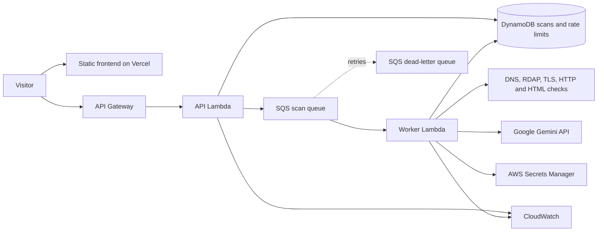

# Digital Graveyard

Digital Graveyard is a passive website security assessment tool. It combines a static web interface, an asynchronous AWS scanning backend, deterministic security scoring, and an AI-generated explanation of collected evidence.

The production frontend is hosted on Vercel. The scanning API and worker run on AWS in `ap-south-1`. Gemini is used for the AI briefing; the API key stays in AWS Secrets Manager and is never sent to the browser.

## Live deployment

- **Website:** https://digital-graveyard-swamivireshs-projects.vercel.app/
- **Scanner:** https://digital-graveyard-swamivireshs-projects.vercel.app/scan/
- **Report:** https://digital-graveyard-swamivireshs-projects.vercel.app/report/
- **API base:** https://maw3v11256.execute-api.ap-south-1.amazonaws.com/prod

The frontend is static and has no bundler/build step. The `.vercelignore` file excludes the AWS backend from the Vercel frontend deployment; deploy the backend separately with AWS SAM.

## What it does

- Accepts a website URL and queues a scan for asynchronous processing.
- Checks URL safety before connecting, including DNS resolution and public-address validation.
- Collects passive evidence from TLS certificates, DNS/RDAP, HTTP response headers, and bounded HTML content.
- Calculates a deterministic security score from available evidence.
- Uses Gemini to summarize the apparent purpose of a website, explain evidence, and organize positive signals, concerns, recommendations, and limitations.
- Displays scan status, findings, evidence, and the final report.

The tool does **not** run a browser, execute website JavaScript, download files, crawl linked pages, or verify the real-world identity of a website operator. Results are evidence-based indicators, not a guarantee that a website is safe or malicious.

## Architecture



The API Lambda validates submissions, applies per-IP rate limits, stores scan state, and places jobs on SQS. The worker performs the checks and stores the completed report in DynamoDB. The frontend polls scan status and loads the report when processing is complete.

## Repository layout

- `index.html`, `scan/`, `report/` — static frontend pages.
- `src/app.js` — frontend interactions, scan polling, and live report rendering.
- `src/config.js` — reads the API base URL from the page's `dg-api-base` meta tag.
- `src/custom.css` — shared site styling and report presentation.
- `backend/template.yaml` — AWS SAM infrastructure definition.
- `backend/src/api/handlers.ts` — scan submission, status, report and CORS handlers.
- `backend/src/worker/handler.ts` — SQS worker and scan lifecycle.
- `backend/src/core/url-safety.ts`, `safe-fetch.ts` — URL validation, DNS checks, pinned-address requests and redirect validation.
- `backend/src/core/analyzers.ts` — TLS, domain/DNS, HTTP and HTML analysis.
- `backend/src/core/reputation.ts` — optional reputation-provider integration.
- `backend/src/core/scoring.ts` — deterministic security scoring and findings.
- `backend/src/core/bedrock.ts` — legacy filename; currently contains the Gemini API integration and structured AI response validation.
- `backend/src/core/scanner.ts` — evidence orchestration and report creation.
- `backend/test/` — offline backend tests.

## AI analysis

The current AI provider is **Google Gemini**, using the model configured by `GeminiModelId` (the current default is `gemini-3.5-flash-lite`).

The worker retrieves the Gemini API key from AWS Secrets Manager using its execution role, then calls the Gemini API server-to-server. Website-derived content is treated as untrusted input. Only bounded, relevant evidence is sent, and the returned JSON is validated against a schema before it is included in the report.

The deterministic security score is calculated separately. Gemini explains the collected evidence; it does not calculate, change, or override the score. If AI generation is unavailable or the response is invalid, the deterministic report remains available and the AI explanation is marked unavailable.

**Never put the Gemini API key in frontend files, commit it to Git, or expose it in a browser request.**

## Frontend development

Run the static site from the repository root:

```sh
python3 -m http.server 5173
```

Open http://localhost:5173.

The scanner and report pages each contain a `meta[name="dg-api-base"]` value. For a live local integration, set both values to the API base URL and configure the backend CORS allowlist for the local origin. Use a separate development SAM stack for local testing; the production CORS allowlist should remain restricted to the deployed Vercel origin.

To exercise the explicitly labelled sample flow, open:

```text
http://localhost:5173/scan/?demo=1
```

## Backend development and tests

Requirements:

- Node.js 24 or later
- npm
- AWS CLI and AWS SAM CLI for deployment
- Docker only when using SAM's local Lambda emulation

Run the offline checks:

```sh
cd backend
npm ci
npm run check
```

`npm run check` compiles the TypeScript backend and runs the automated tests. The tests use controlled fixtures and AWS SDK mocks; they do not create cloud resources or scan arbitrary live websites.

## AWS deployment

The backend is deployed separately from the static frontend using the SAM template in `backend/template.yaml`.

### Required configuration

| SAM parameter | Purpose |
| --- | --- |
| `AllowedOrigins` | Exact browser origin(s) allowed by CORS. Use the production Vercel origin for the production stack. |
| `GeminiModelId` | Gemini model ID; defaults to `gemini-3.5-flash-lite`. |
| `GeminiSecretArn` | ARN of the AWS Secrets Manager secret containing the Gemini API key. Required by the worker. |
| `ReputationSecretArn` | Optional Secrets Manager secret for reputation-provider credentials. |
| `MaxScansPerMinute` | Per-source-IP scan submission limit; default is 5. |
| `MaxConcurrentScans` | Maximum concurrent SQS-triggered worker executions; default is 5. |
| `RiskModerateThreshold`, `RiskHighThreshold`, `RiskCriticalThreshold` | Ordered score thresholds; defaults are 25, 50 and 75. |

Create/store the Gemini key in Secrets Manager before deploying. Do not put the key itself in SAM parameters; pass only the secret ARN. The worker role is granted permission to read the configured secret.

### Build and deploy

From the repository root:

```sh
cd backend
npm ci
npm run check
sam build --template-file template.yaml
```

Deploy the production stack with the production frontend origin and your secret ARN:

```sh
sam deploy \
  --stack-name digital-graveyard \
  --region ap-south-1 \
  --resolve-s3 \
  --capabilities CAPABILITY_IAM \
  --parameter-overrides \
    "AllowedOrigins=https://digital-graveyard-swamivireshs-projects.vercel.app" \
    "GeminiModelId=gemini-3.5-flash-lite" \
    "GeminiSecretArn=${GEMINI_SECRET_ARN}"
```

Set `GEMINI_SECRET_ARN` in your shell to the Secrets Manager ARN before running the command. The production origin must match exactly; do not add localhost to the production allowlist. For local development, use a separate stack with its own origin configuration.

After deployment, use the CloudFormation output `ApiBaseUrl` as the API base. Keep the `dg-api-base` meta value in both `scan/index.html` and `report/index.html` in sync with that output. The currently deployed production API base is listed above.

## API endpoints

The API base URL is the SAM output `ApiBaseUrl`.

### `POST /api/scans`

Submit a URL:

```json
{ "url": "https://example.com" }
```

A successful submission returns HTTP `202` with a `scanId` and queued status.

### `GET /api/scans/{scanId}`

Returns the scan status, progress, current stage and timestamps. Status values include `QUEUED`, `RUNNING`, `COMPLETED` and `FAILED`.

### `GET /api/scans/{scanId}/report`

Returns HTTP `409` while the report is still processing. Once completed, it returns the report, including the deterministic score, factors, findings, evidence, AI explanation and limitations.

Scan records are configured to expire after seven days.

## Security controls and limitations

- Only HTTP and HTTPS URLs using standard ports are accepted.
- Localhost, private, loopback, link-local, multicast and reserved IP destinations are rejected.
- DNS answers are validated before a scan; redirects are revalidated before following them.
- The scanner uses bounded requests, timeouts and response sizes, and follows at most five redirects.
- Website scripts are not executed. HTML is parsed as data.
- Missing or unavailable checks are reported as unavailable; they are not treated as clean results.
- Domain, DNS and reputation data can be incomplete or rate limited.
- The public API is currently anonymous. Rate limits and API Gateway throttling reduce abuse but do not replace authentication or a full abuse-prevention system.

Before a broad public launch, consider authentication, AWS WAF/bot controls, abuse monitoring, alerting and an operational response process.

## Scoring

Each factor has a strength value from 0–100; a higher value represents more favorable observed evidence. Unavailable factors are omitted from the weighted mean rather than treated as suspicious.

| Factor | Weight |
| --- | ---: |
| SSL/TLS | 25% |
| Domain/RDAP | 15% |
| HTTP security | 20% |
| Page content | 25% |
| Reputation | 15% |

The backend also considers severity-weighted findings. High- and critical-severity findings can enforce a minimum overall risk band even when other factors appear healthy. The AI explanation does not alter this calculation.

## Costs

The AWS deployment can incur charges for API Gateway, Lambda, SQS, DynamoDB, CloudWatch and Secrets Manager. Gemini API usage and optional reputation services may add usage-based charges. Review the relevant provider pricing and quotas for your region before running a public service.
