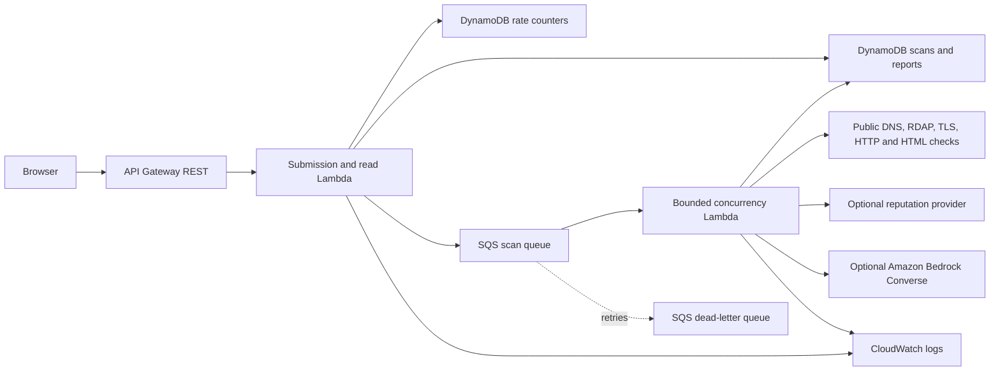

# Digital Graveyard

Digital Graveyard is a static three-page website-risk frontend with an optional AWS-backed asynchronous scanner. The AWS backend is implemented in `backend/`; the static site keeps its existing routes, design, imagery, and interaction patterns.

## Pages

- `/` — Landing page.
- `/scan/` — URL submission, scan progress, and explicitly labelled demo mode.
- `/report/` — Investigation report with findings and expandable evidence.

## Frontend development

The frontend has no build step:

```sh
python3 -m http.server 5173
```

Open `http://localhost:5173`. With the API base URL left empty in the scan and report page `meta[name="dg-api-base"]`, the UI uses the labelled demo path. To use a deployed backend, set that meta value on both pages to the API output URL, including `/prod`, for example `https://abc123.execute-api.us-east-1.amazonaws.com/prod`. Never place AWS credentials or third-party API keys in frontend files.

When the API URL is configured, the scanner POSTs a URL, polls scan status, and opens `/report/?scanId=...` on completion. The report retrieves its evidence from the API. API/network failures are shown to the user; live mode does not silently show fixture values. To explicitly exercise the sample flow while the API is configured, open `/scan/?demo=1`.

## AWS architecture

`backend/template.yaml` is the AWS SAM infrastructure definition.



The worker has reserved concurrency, SQS retries and a DLQ. Scan and rate-limit tables use on-demand billing and server-side encryption; scan records expire after seven days. API Gateway throttling and a DynamoDB per-source-IP minute counter cap submissions. Lambda logs contain request/job IDs and error summaries, not target response bodies.

The static UI can be hosted on Netlify, Vercel, or any static origin. Add that exact origin to the backend CORS allowlist. AWS resources are not deployed by this repository change.

## Backend layout

- `backend/src/api/handlers.ts` — REST API, validation, rate limiting, queue submissions, status/report reads.
- `backend/src/worker/handler.ts` — SQS worker, state transitions, persistence and retry behavior.
- `backend/src/core/url-safety.ts`, `safe-fetch.ts` — URL validation, public-address checks, pinned-address requests and redirects.
- `backend/src/core/analyzers.ts` — TLS, RDAP/DNS, HTTP headers and bounded HTML parsing.
- `backend/src/core/reputation.ts` — extensible provider interface and optional VirusTotal adapter.
- `backend/src/core/scoring.ts` — deterministic scoring and severity-aware findings.
- `backend/src/core/bedrock.ts` — optional evidence-only, schema-validated Bedrock explanation.
- `backend/src/core/scanner.ts` — evidence orchestration and report creation.
- `backend/test/` — offline tests with AWS SDK mocks and controlled fixtures.

## Security controls and limits

- Only HTTP/HTTPS and standard ports are accepted. Credentials in URLs, localhost, private, loopback, link-local, multicast, reserved, and mixed public/private DNS answers are rejected.
- DNS is resolved and every result checked before submission and again by the worker. Requests connect to a validated resolved address while retaining the original hostname for HTTP Host and TLS SNI. Each redirect is parsed, resolved, and revalidated before a connection.
- The scanner uses GET only, follows at most five redirects, applies connection and inactivity timeouts, and caps response bodies at 512 KiB. Website JavaScript and downloads are never executed or fetched. HTML is parsed as data with `parse5`.
- Analysis findings are evidence-based indicators, not a guarantee that a site is safe or malicious. Missing checks remain unavailable and do not alone increase the score. RDAP, DNS and reputation providers can be incomplete or rate limited.
- The default reputation provider is optional VirusTotal domain lookup. If no secret/API key is configured, the report explicitly says the check was unavailable. Configure a Secrets Manager secret with JSON such as `{"virusTotalApiKey":"REPLACE_ME"}`; the key stays server-side.
- Bedrock is optional. A missing model ID, unsupported model/region, permissions issue, or invalid model output leaves the deterministic report intact and marks the AI explanation unavailable. Website text is not sent to Bedrock; only bounded structured evidence is sent, marked untrusted, and validated on return.
- The public API is anonymous by design for this prototype. Before a broad public launch, consider adding user authentication, AWS WAF/bot controls, abuse monitoring and an operational response process. API Gateway throttling and per-IP limits reduce abuse but are not identity guarantees.
- This implementation does not run a browser, inspect JavaScript behavior, download files, crawl linked pages, or confirm brand ownership. Content signals are heuristic and can produce false positives/negatives.

## Scoring

Each category's strength is 0–100; higher means more favorable observed evidence. Unavailable factors are `null` and omitted from the weighted mean rather than treated as suspicious.

| Factor | Weight |
| --- | ---: |
| SSL/TLS | 25% |
| Domain/RDAP | 15% |
| HTTP security | 20% |
| Page content | 25% |
| Reputation | 15% |

The backend caps each category's summed finding points at 35 (`info 0`, `low 3`, `medium 9`, `high 18`, `critical 28`). Per available category, it takes the larger of `min(100, category points × 3.5)` and `min(100, (100 − factor strength) × 0.75)`, then calculates the weighted mean using the weights above and rounds to an integer. Missing factors are omitted and remaining weights are renormalized; if every factor is unavailable, the score is 0 with an `unknown` band. A high or critical finding enforces at least its corresponding global band threshold. This makes urgent evidence visible even when other categories look healthy. The initial band thresholds are `0–24 low`, `25–49 moderate`, `50–74 high`, and `75–100 critical`. Adjust `RISK_MODERATE_THRESHOLD`, `RISK_HIGH_THRESHOLD`, and `RISK_CRITICAL_THRESHOLD` in the SAM template/environment; they must remain ordered and within 0–100.

Every finding includes a stable ID, category, severity, title, explanation, evidence, risk contribution, confidence and recommendation. The LLM never supplies or changes the deterministic score.

## API

The base URL is the SAM output `ApiBaseUrl`, e.g. `https://{api-id}.execute-api.{region}.amazonaws.com/prod`.

### `POST /api/scans`

```json
{"url":"https://example.com"}
```

Returns `202`:

```json
{"scanId":"uuid","status":"queued","message":"Scan successfully queued"}
```

Invalid URLs return `400`; SSRF/private targets return `400`; unresolvable hosts return `422`; rate-limited submissions return `429`.

### `GET /api/scans/{scanId}`

Returns `scanId`, `targetUrl`, `status` (`QUEUED`, `RUNNING`, `COMPLETED`, or `FAILED`), `progress`, `stage`, timestamps, and sanitized error details when applicable.

### `GET /api/scans/{scanId}/report`

Returns `409` with progress until the scan is complete, then the report object with risk score/band, factors, summary, SSL, domain/DNS, HTTP, content, reputation, AI explanation, findings, evidence, limitations and timestamp. Records are retained for up to seven days.

## Local checks

Requirements: Node.js 24 or later, npm, AWS SAM CLI, AWS CLI; Docker is needed for `sam local`.

```sh
cd backend
npm ci
npm run check
```

`npm run check` compiles TypeScript and runs the offline tests. The API tests mock DynamoDB and SQS; they do not create AWS resources or scan live sites. `sam local start-api` can run the Lambda handlers locally, but needs reachable configured AWS tables/queue to exercise real queue persistence; for no-AWS development use the offline tests and the frontend's labelled demo mode. No endpoint tests scan public websites.

## AWS configuration and deployment

1. Install/configure AWS CLI and AWS SAM CLI. Choose an AWS account and region. Ensure your deployment principal can create CloudFormation, API Gateway, Lambda, IAM, SQS, DynamoDB, CloudWatch and (if selected) Bedrock/Secrets Manager resources.
2. Check the current model list in the intended region; do not copy an old model ID blindly:

   ```sh
   aws bedrock list-foundation-models --region us-east-1 --by-output-modality TEXT --query 'modelSummaries[].{id:modelId,name:modelName,provider:providerName}'
   ```

   Select a foundation model that currently supports Converse in that region. Check the [Bedrock model compatibility and region tables](https://docs.aws.amazon.com/bedrock/latest/userguide/models.html) and [Converse API documentation](https://docs.aws.amazon.com/bedrock/latest/userguide/conversation-inference.html). Model access/terms can be account-specific.
3. From the repository root:

   ```sh
   cd backend
   npm ci
   npm run check
   sam build --template-file template.yaml
   sam deploy --guided --template-file .aws-sam/build/template.yaml
   ```

   At the prompts, set stack name, AWS region, `AllowedOrigins` to the exact frontend origin (for local testing, `http://localhost:5173`), `BedrockRegion`, and `BedrockModelId` to the checked model ID. Leave `ReputationSecretArn` empty unless you have configured the optional secret. Choose `Y` for the SAM change set and save the deployment configuration if desired.
4. Read `ApiBaseUrl` from the CloudFormation/SAM outputs. Set the `dg-api-base` meta value in both `scan/index.html` and `report/index.html` to that URL (including `/prod`), then redeploy the static files.
5. Exercise `POST /api/scans` with a permitted public site you control, then poll the returned scan ID. Do not run aggressive scans. Review CloudWatch logs and the DLQ during staging.

SAM commands for subsequent updates:

```sh
cd backend
npm ci
npm run check
sam build --template-file template.yaml
sam deploy --template-file .aws-sam/build/template.yaml --stack-name digital-graveyard --region us-east-1 --capabilities CAPABILITY_IAM --parameter-overrides AllowedOrigins=https://YOUR-FRONTEND.example BedrockRegion=us-east-1 BedrockModelId=YOUR_CHECKED_MODEL_ID
```

The template grants the worker `bedrock:InvokeModel` only on the configured regional foundation model ARN. If you change to a cross-region inference profile, review and narrow/update that IAM resource to the exact profile ARN before deployment.

## Cost and deployment notes

The template uses API Gateway REST, Lambda, SQS, DynamoDB on-demand tables, CloudWatch logs, and optionally Bedrock inference and Secrets Manager. These services can incur charges. Bedrock inference and reputation APIs may add variable costs or use paid quotas. Set API throttling, per-IP limits, reserved worker concurrency, response-size caps and retention conservatively. Review current AWS pricing for your region before deployment. This repository does not deploy, enable model access, create a secret, or incur AWS charges.

## Static hosting

The frontend remains static. Existing hosting setup files are retained. For Netlify or Vercel hosting, deploy the repository root as before; the backend is separately deployed with SAM. Keep the frontend's `dg-api-base` meta values in sync with the SAM output and its CORS `AllowedOrigins` parameter.

### Environment variable reference

| Variable / SAM parameter | Purpose |
| --- | --- |
| `AWS_REGION` | Region for DynamoDB, SQS, Secrets Manager, and default AWS clients. |
| `BedrockRegion` / `BEDROCK_REGION` | Region in which the selected Bedrock model is enabled. |
| `BedrockModelId` / `BEDROCK_MODEL_ID` | Exact current foundation model ID; blank disables AI explanations. |
| `AllowedOrigins` / `ALLOWED_ORIGINS` | Comma-separated exact browser origins allowed by CORS. |
| `SCAN_TABLE_NAME`, `RATE_TABLE_NAME`, `SCAN_QUEUE_URL` | SAM-provided resource names/URL; normally do not set manually in AWS. |
| `MaxScansPerMinute` / `MAX_SCANS_PER_MINUTE` | Per-source-IP submission cap for each one-minute bucket. |
| `MaxConcurrentScans` | Reserved worker concurrency and corresponding maximum active scan workers. |
| `RiskModerateThreshold`, `RiskHighThreshold`, `RiskCriticalThreshold` | Ordered score cutoffs for the risk bands (defaults 25, 50, 75). |
| `ReputationSecretArn` / `REPUTATION_SECRET_ARN` | Optional Secrets Manager ARN holding provider credentials. |

### IAM permissions

SAM generates the execution roles. The API role is limited to the two tables and scan queue: DynamoDB item reads/writes and SQS `SendMessage`. The worker role is limited to the scan table, its SQS event source mapping, the configured Bedrock foundation-model ARN (`bedrock:InvokeModel`), and—only when configured—the one reputation secret (`secretsmanager:GetSecretValue`). Lambda logging/tracing permissions are added by SAM. The deployment principal additionally needs CloudFormation and permission to create these resources and their roles; use a deployment role rather than long-lived broad user credentials.

### Example requests

```sh
API_BASE='https://YOUR_API_ID.execute-api.us-east-1.amazonaws.com/prod'
curl -i -X POST "$API_BASE/api/scans" -H 'Content-Type: application/json' -d '{"url":"https://example.com"}'
curl -i "$API_BASE/api/scans/SCAN_ID"
curl -i "$API_BASE/api/scans/SCAN_ID/report"
```

The last request returns `409` until the queue worker completes. These examples are for a deployment you control; they are not part of the offline tests.
